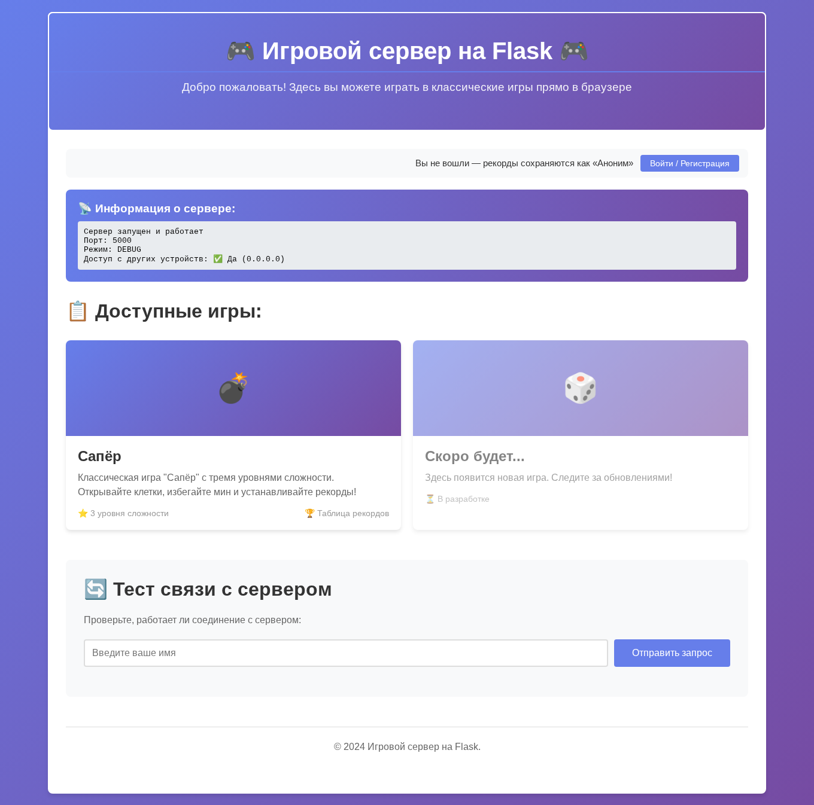
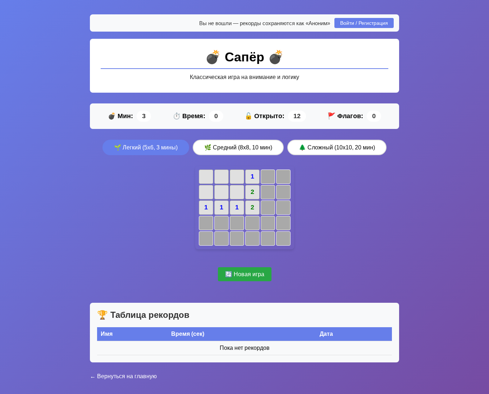

# Сапёр на Flask

Учебное веб-приложение с игрой «Сапёр», регистрацией, входом и таблицей рекордов по уровням сложности.

**Python · Flask · REST API · JSON · JavaScript · HTML/CSS**

- `app.py` обслуживает страницы и API для регистрации, входа, сессий и рекордов. Игровая логика основного варианта находится в браузере.
- `app_new.py` содержит отдельный вариант с серверными эндпоинтами для игры.
- `templates/` и `static/` содержат интерфейс и клиентский код.

## Скриншоты

### Главная страница



### Игра «Сапёр»



## Локальный запуск

```sh
python -m venv .venv
```

Активируйте окружение командой `source .venv/bin/activate` в Linux/macOS или `.venv\Scripts\Activate.ps1` в Windows PowerShell. Затем выполните:

```sh
python -m pip install -r requirements.txt
python -m flask --app app run
```

Откройте <http://127.0.0.1:5000>. Приложение создаёт локальную папку для данных при запуске.

Пример данных для таблицы рекордов находится в [data/scores.example.json](data/scores.example.json). Для демонстрации скопируйте его в `data/scores.json` перед запуском. Имена и даты в примере условные.
